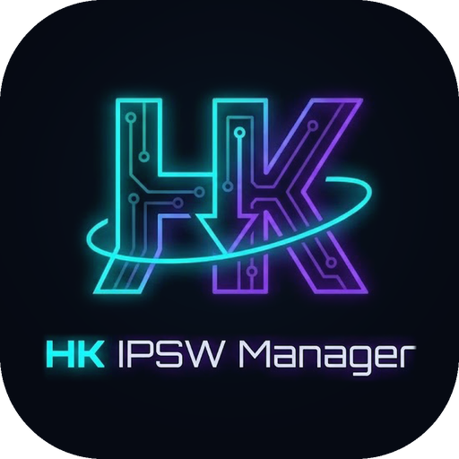

# HK IPSW Manager



**Made By Hisham Khateeb for the Community.**
Telegram: [t.me/xavior963](https://t.me/xavior963) · Website: [Hishamkhateeb.com](https://hishamkhateeb.com)

Flutter desktop app (Windows 10/11 x64 + macOS) for browsing, bulk-downloading,
deduplicating and auditing Apple IPSW firmware from IPSW.me v4.

## Layout

```
lib/
├── main.dart                           # Hive init, settings/catalog boxes, ProviderScope
├── core/theme, core/utils              # HUD tokens + theme, byte/rate/ETA formatting
├── domain/
│   ├── entities/                       # PlatformType, Device, IpswRelease/IpswGroup,
│   │                                   # DownloadTask, AppSettings
│   └── repositories/                   # DownloadTaskRepository, LinkResolver
├── data/
│   ├── api/ipsw_api_client.dart        # /devices, /device/{id}, /ipsw/{ver}, /model/{A-number}
│   ├── cache/catalog_cache.dart        # Hive: devices (24 h TTL), firmware (6 h TTL), model map
│   ├── repositories/                   # catalog (cache-first + parallel sync), settings, queue JSON
│   └── resolvers/ipsw_me_link_resolver.dart
├── services/
│   ├── catalog/                        # SearchQuery parser, CatalogIndex (search, dedupe, sort)
│   └── download/                       # chunked engine, queue manager, throttler, SHA1 isolate
└── presentation/
    ├── providers/                      # core, catalog, download, ui (Riverpod 3)
    ├── shell/                          # AppShell, Sidebar, HudHeader (search + telemetry)
    ├── widgets/hud_widgets.dart        # GlassPanel, NeonButton, PulseDot, Sparkline, …
    └── screens/
        ├── library/                    # browse + search, shared-payload tiles, bulk selection bar
        ├── queue/                      # bandwidth meter, per-thread visualizer, task controls
        ├── settings/                   # folders, threads, concurrency, caps, SHA1, cache
        └── repository/                 # inventory, missing-latest diff, duplicate reclaim
```

## Search syntax

`iPhone 15 Pro` · `Mac14,2` · `A2442` · `iOS 18.0.1` · `macOS Sequoia` · `22A3354` ·
`is:signed` / `is:unsigned` · `platform:ios|ipados|macos` · `chip:m-series` (or a SoC
prefix like `chip:t8112`) · `version:18.0` · `build:22A`. Bare numbers ("15") only match
device names, never OS versions.

## Download engine

- **Probe** `Range: bytes=0-0` → total size (from `Content-Range`), range support, ETag.
- **Pre-allocate** the `.hkdl` partial at full size (`SetEndOfFile` on NTFS),
  then every thread writes at its own offset. No merge step: finishing is a rename.
- **Dynamic segmentation**: a thread that finishes takes the back half of the
  largest remaining chunk, so one slow connection can't hold up the end of the file.
- **Resume**: chunk map checkpointed to `<file>.hkdl.json` every 3 s. Reused only
  if the remote size/ETag still match. Writes use `If-Range`, so if the file
  changed on the server you get a full-file 200 instead of the wrong bytes.
- **Link refresh**: 401/403/410 → `LinkResolver` re-queries IPSW.me for the same
  build/SHA1 → existing chunks resume on the new URL (up to 3 times per run).
- **SHA1** runs on a background isolate after the download slot is freed.

```
flutter test        # engine + manager tests against a local range server
flutter run -d macos   # or -d windows
```

## Repository scanner

- Finds every `.ipsw` under the repository folder and reads `BuildManifest.plist`
  straight from the ZIP/ZIP64 central directory (a few KB per file, no extraction).
- Matches files to the catalog by build + supported devices, with Apple's filename as
  a fallback; flags size mismatches, SHA1 mismatches and unreadable files.
- Results (and any computed SHA1) are cached per path + size + mtime, so rescans are instant.
- Hardlinked names are grouped as one physical file (`stat` inode / `fsutil hardlink list`).
- **Missing firmware**: devices whose latest signed IPSW isn't present, deduplicated by
  payload, with "Queue all missing".
- **Duplicates**: the same payload stored twice. Merging only happens when the SHA1s match,
  and replaces the extra copies with hardlinks (`ln` / `mklink /H`).
- **Per-device names**: `By Device/<identifier>_<version>_<build>_Restore.ipsw` hardlinks,
  created automatically after each download (Settings → Per-device hardlinks).

Dev/QA launch flags: `--dart-define=HK_START_SECTION=repository`,
`--dart-define=HK_START_SEARCH="is:signed platform:ios"`, `--dart-define=HK_REPO_DIR=/path`.
